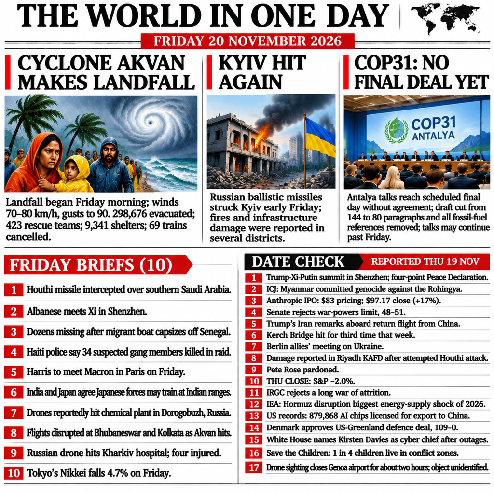

[](https://make.fun/bounty/news-image-20261120?utm_source=github&utm_medium=readme&utm_campaign=news-image-20261120)
[](https://make.fun/bounty/news-image-20261120/leaderboard?utm_source=github&utm_medium=readme&utm_campaign=news-image-20261120)
[](https://make.fun/bounty/news-image-20261120?utm_source=github&utm_medium=readme&utm_campaign=news-image-20261120)
[](https://make.fun/bounty/news-image-20261120)

# The World in One Day — 20 November 2026

A square newspaper front page with a black serif masthead, a red **FRIDAY 20 NOVEMBER 2026** date banner, three illustrated lead-story panels, numbered Friday briefs, and a black-and-red **DATE CHECK** box. It contains **30 stories total: 3 Friday leads + 10 Friday briefs + 17 Thursday items**.



## What the image reports

The summaries below describe the image's headlines and captions, preserving their dates, attribution, and uncertainty.

### Three Friday lead stories

1. **Cyclone Akvan makes landfall:** Landfall begins Friday morning, with winds of 70–80 km/h gusting to 90 km/h; 298,676 people evacuated, 423 rescue teams, 9,341 shelters, and 69 trains cancelled.
2. **Kyiv hit again:** Russian ballistic missiles strike Kyiv early Friday; fires and infrastructure damage are reported in several districts.
3. **COP31: no final deal yet:** Talks in Antalya reach their scheduled final day without a final agreement. The draft is cut from 144 to 80 paragraphs and all fossil-fuel references are removed; talks may continue past Friday.

### Ten Friday briefs

1. Houthi missile intercepted over southern Saudi Arabia.
2. Albanese meets Xi in Shenzhen.
3. Dozens missing after a migrant boat capsizes off Senegal.
4. Haiti police say 34 suspected gang members were killed in a raid.
5. Harris to meet Macron in Paris on Friday.
6. India and Japan agree Japanese forces may train at Indian ranges.
7. Drones reportedly hit a chemical plant in Dorogobuzh, Russia.
8. Flights disrupted at Bhubaneswar and Kolkata as Akvan hits.
9. A Russian drone hits a Kharkiv hospital; four injured.
10. Tokyo's Nikkei falls 4.7% on Friday.

### DATE CHECK — REPORTED THU 19 NOV

The image labels this box **REPORTED THU 19 NOV**: all 17 items were reported on Thursday 19 November 2026 and provide explicitly dated context for Friday's front page. **THU CLOSE** refers to Thursday's market close; the object in the Genoa sighting remains unidentified.

1. Trump-Xi-Putin trilateral summit in Shenzhen and a four-point Peace Declaration.
2. ICJ ruling that Myanmar committed genocide against the Rohingya.
3. Anthropic IPO: $83 pricing, $97.17 close, +17%.
4. Senate rejects a war-powers limit, 48-51.
5. Trump's Iran remarks aboard the return flight from China.
6. Kerch Bridge hit for a third time that week.
7. Berlin allies' meeting on Ukraine.
8. Damage reported in Riyadh KAFD after an attempted Houthi attack.
9. Pete Rose pardoned.
10. **THU CLOSE:** S&P -2.0%.
11. IRGC rejects a long war of attrition.
12. IEA says Hormuz disruption is the biggest energy-supply shock of 2026.
13. US records 879,868 AI chips licensed for export to China.
14. Denmark approves the US-Greenland defence deal, 109-0.
15. White House names Kirsten Davies as cyber chief after US outages.
16. Save the Children: 1 in 4 children live in conflict zones.
17. A drone sighting closes Genoa airport for about two hours; the object is unidentified.

## Competition

An entry for make.fun's **news-image-20261120** bounty: **"Sum up 20 November's world news in one image"**.

- **Prize pool:** $250.
- **Entry:** Free; the top 50 are paid.
- **Deadline:** 22 November 2026 07:00 WIB.
- **Judge:** `glm-5.3-flash`.

Judging criteria, in order:

1. One day's news with that day's names, recognizable events and a visible date.
2. Story selection and breadth.
3. Clarity from the image alone.
4. Faithful reporting without treating hype as fact.
5. Craft and legibility at about 300 pixels.

## Run

Requires **Node.js 22.18 or later**, using native TypeScript execution. There are no dependencies to install. From the repository directory:

```sh
npm start
```

This runs `node main.ts` and writes `/output/entry.png` by default. To choose an output directory:

```sh
MAKEFUN_OUTPUT_DIR=/tmp/news-frontpage-output npm start
```

The script also works when invoked by absolute path from any working directory:

```sh
MAKEFUN_OUTPUT_DIR=/tmp/news-frontpage-output node /absolute/path/to/repo/main.ts
```

`main.ts` resolves the bundled `entry.png` relative to its own directory using `fileURLToPath(import.meta.url)`. It creates the output directory, copies the image byte-for-byte, and validates the **copied file**: JPEG markers and frame/scan structure, dimensions of exactly **1024×1024**, and a size of at most **1,048,576 bytes (1 MiB)**. Invalid output throws a clear error; success prints the output path, dimensions, and byte size. The program makes no network calls.

The bundled image is pre-rendered. `frontpage-source.png` is the preserved **1254×1254 PNG** source. `entry.png` was produced with Pillow using Lanczos resizing, JPEG quality 95, no chroma subsampling, and optimized encoding. Its `.png` filename is intentional: **the file contents are JPEG**.

### Final image and verification

- **File:** `entry.png`.
- **Format and dimensions:** JPEG, 1024×1024 pixels.
- **Size:** **595866 bytes**.
- **SHA-256:**

```text
87e9611dc10f90ec7b7da2de523f693f240ff1fd2b7d91f97ce360d9bc37773f
```

Local verification on Node.js v24.22.1 passed: an absolute-path run from a different working directory and an `npm start` run produced byte-identical copies of the bundled image. `sha256sum` and `cmp` confirmed determinism; `file`, byte-size checks, and Pillow decoding confirmed the JPEG, dimension, and size gates.

To repeat the two-output check from the repository directory:

```sh
MAKEFUN_OUTPUT_DIR=/tmp/news-frontpage-a node main.ts
MAKEFUN_OUTPUT_DIR=/tmp/news-frontpage-b node main.ts
sha256sum entry.png /tmp/news-frontpage-a/entry.png /tmp/news-frontpage-b/entry.png
cmp /tmp/news-frontpage-a/entry.png /tmp/news-frontpage-b/entry.png
file entry.png /tmp/news-frontpage-a/entry.png /tmp/news-frontpage-b/entry.png
stat -c '%n: %s bytes' entry.png /tmp/news-frontpage-a/entry.png /tmp/news-frontpage-b/entry.png
```

Built for make.fun. Referral link: https://make.fun/r/p8atzycs
